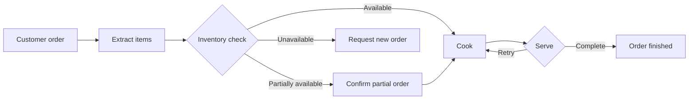

# Restaurant Order Automation Agent

An interactive restaurant ordering assistant built with **Python** and
**LangGraph**. It turns a natural-language order into a small workflow that
checks inventory, handles partial availability, retries failed kitchen and
serving steps, and reports the final result in the terminal.

## What It Does

- Understands orders such as `2 pizzas and 1 coffee`
- Supports numeric quantities and quantities written as words
- Checks each item against the in-memory menu
- Asks whether to continue when only part of an order is available
- Retries cooking and serving failures with state-based counters
- Runs offline with a deterministic parser
- Optionally uses Groq for JSON-based order extraction

## Workflow



## Menu

| Item | Available quantity |
| --- | ---: |
| Pizza | 5 |
| Burger | 4 |
| Pasta | 3 |
| Salad | 6 |
| Coffee | 10 |
| Tea | 8 |
| Sushi | 0 |

## Quick Start

Requirements: **Python 3.12+**.

From the repository root:

```powershell
cd rest_agent
python -m venv .venv
.\.venv\Scripts\Activate.ps1
python -m pip install -e .
python main.py
```

Example session:

```text
You: 2 pizzas and 1 coffee
Assistant: I understood your order as 2 pizza, 1 coffee.
Assistant: Your order is confirmed: 2 pizza, 1 coffee.
```

Type `quit` or `exit` to leave the assistant.

## Optional Groq Extraction

Without configuration, the application uses its built-in offline parser. To
use Groq's JSON extraction API, create a `.env` file in the repository root:

```env
GROQ_API_KEY=your_api_key_here
```

The key is loaded through `python-dotenv` and is intentionally excluded from
Git by `.gitignore`. The configured model is `openai/gpt-oss-120b`.

## Project Structure

```text
.
├── prompt.md              # Project prompt and requirements
├── README.md              # Project documentation
└── rest_agent/
    ├── main.py            # Graph, order logic, and CLI
    ├── pyproject.toml     # Package metadata and dependencies
    └── README.md          # Package-level notes
```

## Technical Notes

The workflow is compiled by `build_graph()` and stores its progress in a
typed `RestaurantState`. The `extract_order` and `llm_extract_order`
functions share the same order contract, so the parser can be swapped without
changing the workflow. Passing custom `extractor` and `random_value`
functions to `build_graph()` makes the workflow straightforward to test.

## License

No license has been added yet.